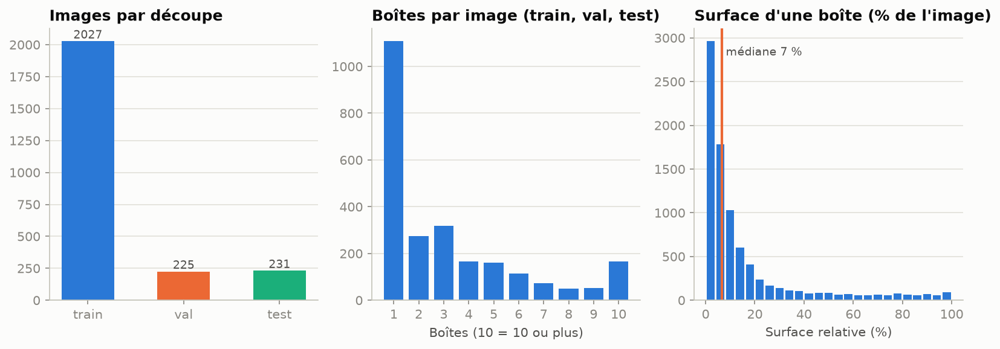
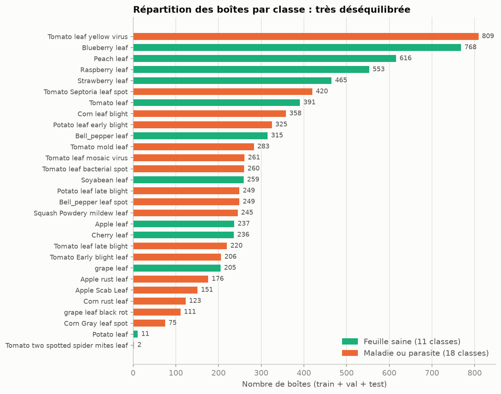
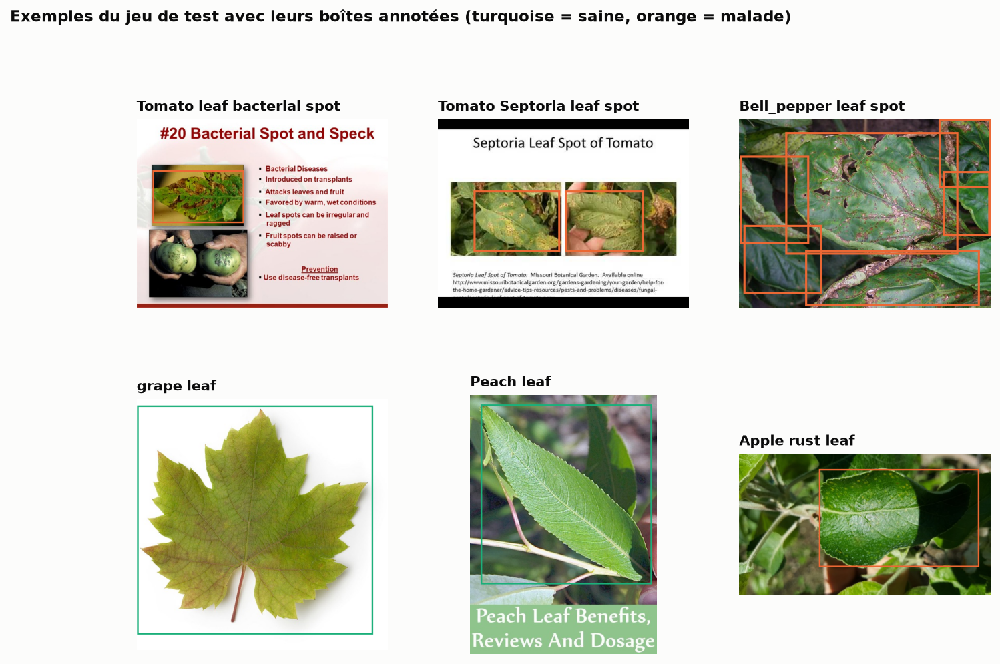
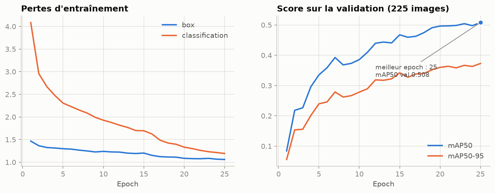
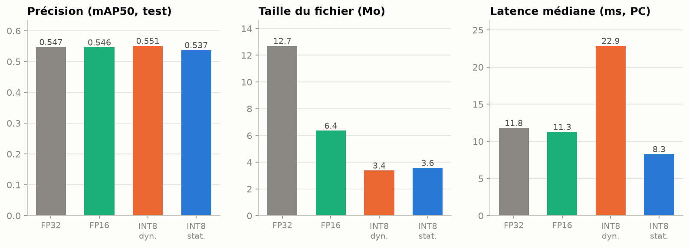
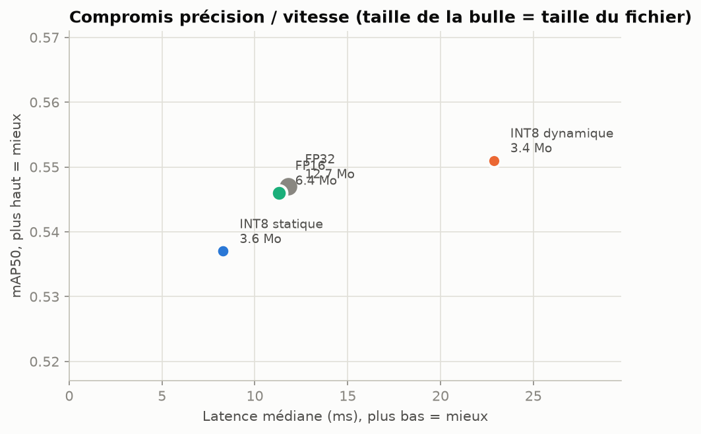
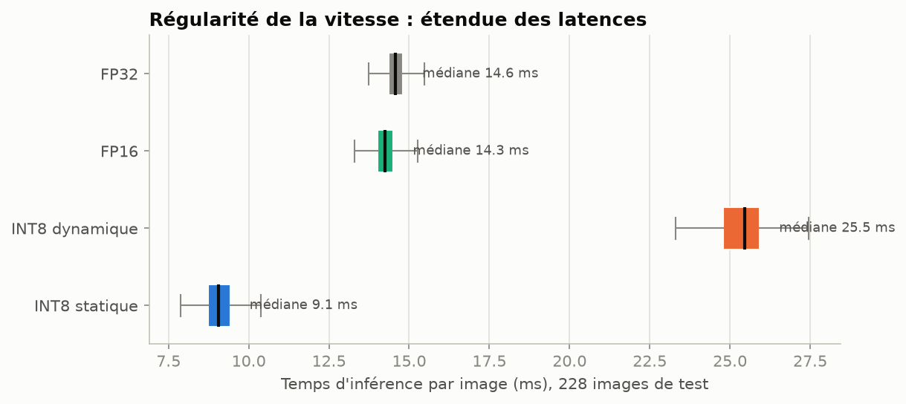
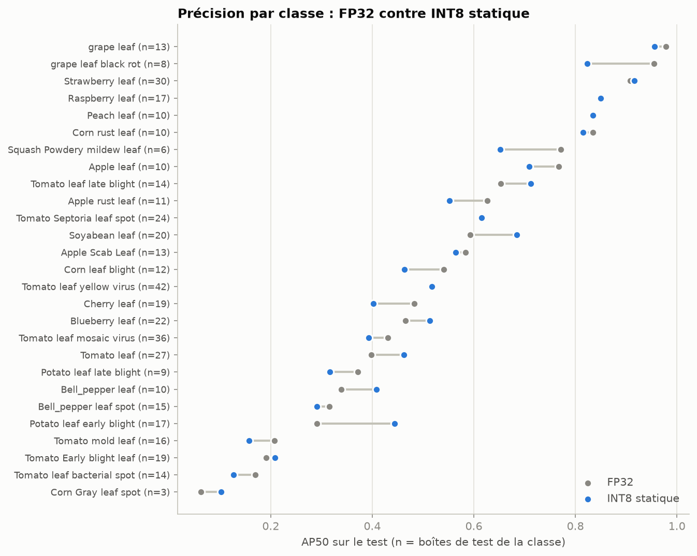
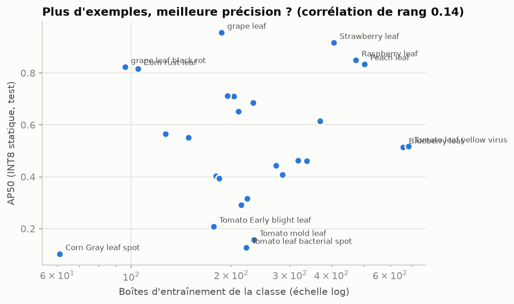

# Analyse exploratoire : PlantDoc embarqué sur Android

Généré par `scripts/eda.py`. Les performances sont celles du jeu de test officiel (231 images) ; les latences sont mesurées sur le CPU du PC, non isolé.

## 1. Chiffres clés

| Indicateur | Valeur |
|---|---|
| Images au total | 2483 (train 2027, val 225, test 231) |
| Boîtes annotées | 8579 (3.5 par image) |
| Classes | 29 (11 saines, 18 maladies ou parasites) |
| Boîtes sur feuilles saines | 47 % (les maladies représentent 53 %) |
| Déséquilibre | classe la plus fréquente : 809 boîtes (Tomato leaf yellow virus) ; la moins fréquente : 2 ; rapport 404:1 |
| Concentration | les 5 classes les plus fréquentes = 37 % des boîtes |
| Surface d'une boîte | médiane 7 % de l'image (boîtes plutôt petites, 3.5 par image en moyenne) |
| Taille des images | côté max médian 640 px (images réduites à 640 px au plus) |
| Entraînement | 25 epochs, meilleur epoch 25, mAP50 validation 0.508 |
| Meilleur modèle déployé | INT8 statique : mAP50 0.537, 3.6 Mo, 8.3 ms |
| Gain INT8 statique vs FP32 | taille ÷3.5, vitesse ×1.42, mAP50 -1.0 point |
| Classes les plus faibles (INT8 stat.) | Corn Gray leaf spot (0.10), Tomato leaf bacterial spot (0.13), Tomato mold leaf (0.16), Tomato Early blight leaf (0.21), Bell_pepper leaf spot (0.29) |
| Plus forte baisse FP32 → INT8 stat. | grape leaf black rot (-13 pts), Squash Powdery mildew leaf (-12 pts), Cherry leaf (-8 pts) |
| Précision vs nombre d'exemples | corrélation de rang (Spearman) 0.14 entre boîtes d'entraînement et AP50 |

## 2. Les données

| Découpe | Images | Boîtes | Boîtes / image | Classes présentes |
|---|---|---|---|---|
| train | 2027 | 7313 | 3.61 | 29 |
| val | 225 | 819 | 3.64 | 28 |
| test | 231 | 447 | 1.94 | 27 |
| total | 2483 | 8579 | 3.46 | 29 |

Lecture : le jeu est très déséquilibré (rapport 404:1 entre la classe la plus et la moins fréquente) et les 2483 images ne contiennent que 8579 boîtes. Les boîtes sont plutôt petites (surface médiane 7 % de l'image, 3.5 boîtes par image en moyenne).

## 3. L'entraînement

Le meilleur epoch (choisi sur la validation, pas sur le test) est le 25 avec un mAP50 de 0.508 ; le dernier epoch donne 0.508. Le meilleur epoch est le dernier : le score montait encore à la fin, donc l'entraînement n'a pas convergé et davantage d'epochs amélioreraient probablement le modèle.

## 4. Les performances

| Variante | mAP50 | mAP50-95 | Taille (Mo) | Latence médiane (ms) | Δ mAP50 vs FP32 (points) | Taille ÷ | Vitesse × |
|---|---|---|---|---|---|---|---|
| FP32 | 0.547 | 0.435 | 12.7 | 11.8 | 0.0 | 1.0 | 1.0 |
| FP16 | 0.546 | 0.435 | 6.36 | 11.3 | -0.1 | 2.0 | 1.05 |
| INT8 dynamique | 0.551 | 0.438 | 3.38 | 22.9 | 0.4 | 3.8 | 0.52 |
| INT8 statique | 0.537 | 0.425 | 3.58 | 8.3 | -1.0 | 3.5 | 1.42 |

Lecture : l'INT8 statique est la variante la plus rapide (8.3 ms) et la deuxième plus légère, pour 1.0 point de mAP50 perdu. L'INT8 dynamique est le plus petit mais le plus lent. Un écart de moins de 1 point de mAP50 entre variantes n'est pas significatif sur ce petit jeu de test.

## 5. Où le modèle se trompe

Lecture : les classes les plus faibles sont Corn Gray leaf spot, Tomato leaf bacterial spot, Tomato mold leaf, Tomato Early blight leaf, Bell_pepper leaf spot. La corrélation de rang entre le nombre d'exemples d'entraînement et l'AP50 est de 0.14. La quantization ne dégrade pas toutes les classes pareil : la plus forte baisse FP32 → INT8 statique est grape leaf black rot (-13 points), qui compte 8 boîtes de test : sur si peu d'exemples, une variation de quelques boîtes suffit à faire bouger l'AP.

## 6. Tableau complet par classe

| Classe | Type | Train | Val | Test | Total | AP50 FP32 | AP50 INT8 stat. |
|---|---|---|---|---|---|---|---|
| Tomato leaf yellow virus | malade | 682 | 85 | 42 | 809 | 0.52 | 0.52 |
| Blueberry leaf | saine | 657 | 89 | 22 | 768 | 0.47 | 0.51 |
| Peach leaf | saine | 503 | 103 | 10 | 616 | 0.84 | 0.83 |
| Raspberry leaf | saine | 474 | 62 | 17 | 553 | 0.85 | 0.85 |
| Strawberry leaf | saine | 407 | 28 | 30 | 465 | 0.91 | 0.92 |
| Tomato Septoria leaf spot | malade | 370 | 26 | 24 | 420 | 0.62 | 0.62 |
| Tomato leaf | saine | 337 | 27 | 27 | 391 | 0.40 | 0.46 |
| Corn leaf blight | malade | 318 | 28 | 12 | 358 | 0.54 | 0.46 |
| Potato leaf early blight | malade | 273 | 35 | 17 | 325 | 0.29 | 0.44 |
| Bell_pepper leaf | saine | 285 | 20 | 10 | 315 | 0.34 | 0.41 |
| Tomato mold leaf | malade | 234 | 33 | 16 | 283 | 0.21 | 0.16 |
| Tomato leaf mosaic virus | malade | 184 | 41 | 36 | 261 | 0.43 | 0.39 |
| Tomato leaf bacterial spot | malade | 222 | 24 | 14 | 260 | 0.17 | 0.13 |
| Soyabean leaf | saine | 233 | 6 | 20 | 259 | 0.59 | 0.69 |
| Potato leaf late blight | malade | 223 | 17 | 9 | 249 | 0.37 | 0.32 |
| Bell_pepper leaf spot | malade | 214 | 20 | 15 | 249 | 0.32 | 0.29 |
| Squash Powdery mildew leaf | malade | 210 | 29 | 6 | 245 | 0.77 | 0.65 |
| Apple leaf | saine | 204 | 23 | 10 | 237 | 0.77 | 0.71 |
| Cherry leaf | saine | 180 | 37 | 19 | 236 | 0.48 | 0.40 |
| Tomato leaf late blight | malade | 195 | 11 | 14 | 220 | 0.65 | 0.71 |
| Tomato Early blight leaf | malade | 177 | 10 | 19 | 206 | 0.19 | 0.21 |
| grape leaf | saine | 187 | 5 | 13 | 205 | 0.98 | 0.96 |
| Apple rust leaf | malade | 149 | 16 | 11 | 176 | 0.63 | 0.55 |
| Apple Scab Leaf | malade | 127 | 11 | 13 | 151 | 0.58 | 0.56 |
| Corn rust leaf | malade | 105 | 8 | 10 | 123 | 0.83 | 0.82 |
| grape leaf black rot | malade | 96 | 7 | 8 | 111 | 0.95 | 0.82 |
| Corn Gray leaf spot | malade | 61 | 11 | 3 | 75 | 0.06 | 0.10 |
| Potato leaf | saine | 4 | 7 | 0 | 11 |  |  |
| Tomato two spotted spider mites leaf | malade | 2 | 0 | 0 | 2 |  |  |
